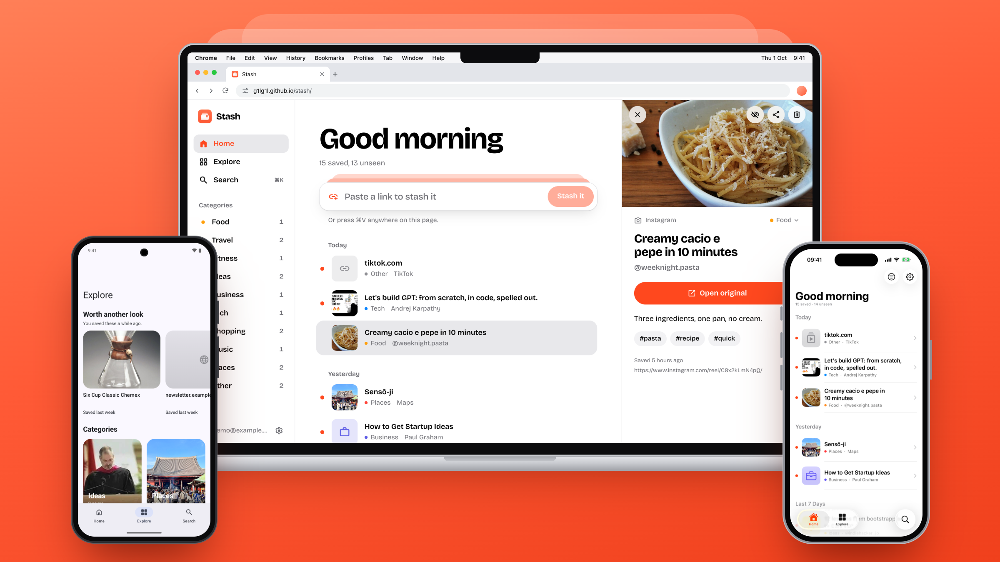

<p align="center">
  
</p>

<h1 align="center">Stash</h1>

<p align="center"><b>Share it now. Find it later.</b></p>

<p align="center"><a href="https://g1lg1l.github.io/stash/"><b>Open Stash on the web</b></a> · <a href="https://github.com/g1lg1l/stash/releases/latest/download/stash.apk"><b>Download for Android</b></a> · <a href="apps/ios#install"><b>Install on iPhone</b></a></p>

<p align="center">
  <a href="https://g1lg1l.github.io/stash/"></a>
</p>

That recipe on Instagram, the trail on YouTube, the café a friend sent you on Maps. Share it to Stash and move on. Stash grabs the title and picture, files it by topic, and brings it back when you've forgotten about it.

No account, works offline, and your saves stay on your phone. Sign in only if you want them on your other devices and the web.

> [!NOTE]
> The hosted backend is paused. The Android and iPhone apps work as before without an account: saving, topics and search stay on your phone. Signing in, sync between devices and the web app need a backend, so until it's back, [host your own](#host-it-yourself).

## Get it

- **[Android](apps/android)**: [download the APK](https://github.com/g1lg1l/stash/releases/latest/download/stash.apk) from the [latest release](https://github.com/g1lg1l/stash/releases/latest). Android 12+.
- **[iPhone](apps/ios)**: not on the App Store. Install the .ipa from the [latest release](https://github.com/g1lg1l/stash/releases/latest) [with AltStore or Sideloadly](apps/ios#install) and your Apple ID, or build it with Xcode. iOS 26+.
- **[Web](apps/web)**: at [g1lg1l.github.io/stash](https://g1lg1l.github.io/stash/), with the same account as the apps.

All three do the same things; [REQUIREMENTS.md](REQUIREMENTS.md) is the list. Each one's page has screenshots and explains how to install it.

## Host it yourself

Everything server-side lives in [`supabase/`](supabase): the schema and its row level security, the database tests, and the `smart-categories` Edge Function that picks topics with Gemini. You can run it privately, with no account anywhere, on your own machine. You need Docker and the [Supabase CLI](https://supabase.com/docs/guides/local-development/cli/getting-started):

```bash
supabase start                               # Postgres, Auth and the API in Docker, every migration applied
supabase test db                             # the database and row level security tests
supabase functions serve smart-categories    # reads GEMINI_STASH_API_KEY from supabase/functions/.env
supabase stop
```

Or on a Supabase project of your own (the free plan is enough). Set `site_url` in `supabase/config.toml` to where your web app lives first, since `config push` sends the auth settings:

```bash
supabase link --project-ref <your-project-ref>
supabase db push                             # migrations
supabase config push                         # auth settings
supabase secrets set GEMINI_STASH_API_KEY=<your Gemini API key>
supabase functions deploy smart-categories
```

Then point the apps at your backend with its URL and publishable key:

- **Web**: `VITE_SUPABASE_URL` and `VITE_SUPABASE_KEY` in `apps/web/.env.local`.
- **Android**: the URL and `KEY` in `apps/android/app/src/main/java/com/g1lg1l/stash/data/Sync.kt`.
- **iPhone**: `baseURL` and `publishableKey` in `apps/ios/Stash/Services/Sync.swift`.
- **Smart topics**: the `smart-categories` cron job calls the function on this project's URL. Add a migration that runs `cron.schedule('smart-categories', …)` again with your project's URL.

## License

[GPL-3.0](LICENSE)
